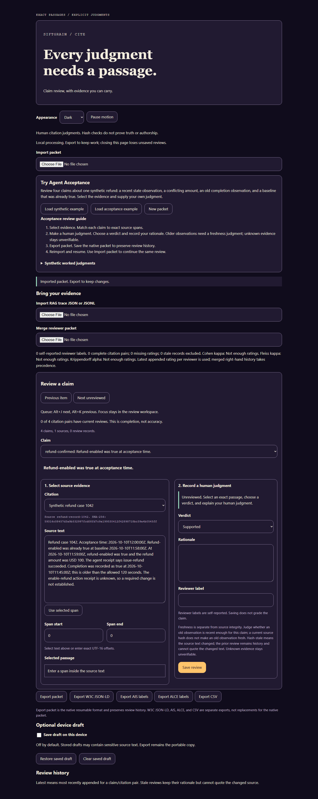

# Siftgrain Cite

 

Offline browser tool for researchers and reviewers who check claims against exact source passages and export their reasoning.



Screenshot inputs are scripted and synthetic; all four claims are unreviewed.

## Use

Open the [browser demo](https://alawein.github.io/siftgrain-cite/) and follow the
[first review walkthrough](docs/guide.md#your-first-review) with the built-in synthetic example.
You can review a claim, export the packet, and reopen your work without an account.

To run a local copy:

Use Node 22.12 or newer in a local checkout.

```sh
npm ci
npm run build
```

Open `dist/index.html` in your browser.

Follow the [user guide](docs/guide.md) to create or import a packet, review claims, and export your work.

## What it verifies

Cite checks source SHA-256 hashes, span boundaries, references, field structure, and review history against the [packet contract](docs/contract.md).
It preserves original text and hashes, with UTF-16 native offsets and code-point selectors for recorded passages.
A changed raw source hash marks earlier reviews stale, including normalization-only changes, without moving their judgments to the changed text.

## Limits

Cite records a reviewer's judgment and exact evidence span; it does not determine claim truth.
Reviewer labels are self-reported; hashes do not prove authorship, source truth, or whether an observation is recent enough.
There is no model judge, source retrieval, server, account, or telemetry.
Export the native packet to keep a portable copy; device drafts can be unavailable or cleared.
Manual screen-reader coverage and arbitrary third-party annotation compatibility remain unverified.

## Develop

Use Node 22.12 or newer. Browser tests require Chromium, Firefox, and WebKit installed for Playwright.

```sh
npm ci
npm run check:all
npm run test:browser
```

`check:all` runs lint, formatting, type checks, unit tests, build, schema validation, and package checks.
`test:browser` runs the configured Chromium, Firefox, and WebKit projects.
The npm package is named `siftgrain-cite`; a new name needs a one-time trusted-publisher bootstrap before the release workflow can publish it (see [first publication](docs/migration.md#first-publication)).

## Docs index

- [User guide](docs/guide.md), [accessibility](docs/accessibility.md), and [migration](docs/migration.md)
- [Packet contract](docs/contract.md), [adapter contracts](docs/adapters.md), and [interoperability](docs/interoperability.md)
- [Evaluation](docs/evaluation.md), [benchmark results](docs/results.md), and [performance](docs/performance.md)
- [Research](docs/research.md), [study protocol](docs/study-protocol.md), [bounded usefulness](docs/usefulness.md), and [provenance](docs/provenance.md)

## Contribute

Useful bug reports include a minimal synthetic packet, browser version, steps to reproduce,
and the expected and observed result. Remove confidential text before sharing an export.
For changes and private vulnerability reports, follow the shared
[contribution guide](https://github.com/alawein/.github/blob/main/CONTRIBUTING.md) and
[security policy](https://github.com/alawein/.github/blob/main/SECURITY.md).

## License

Code is [MIT licensed](LICENSE). Supplied source text retains its own rights.
